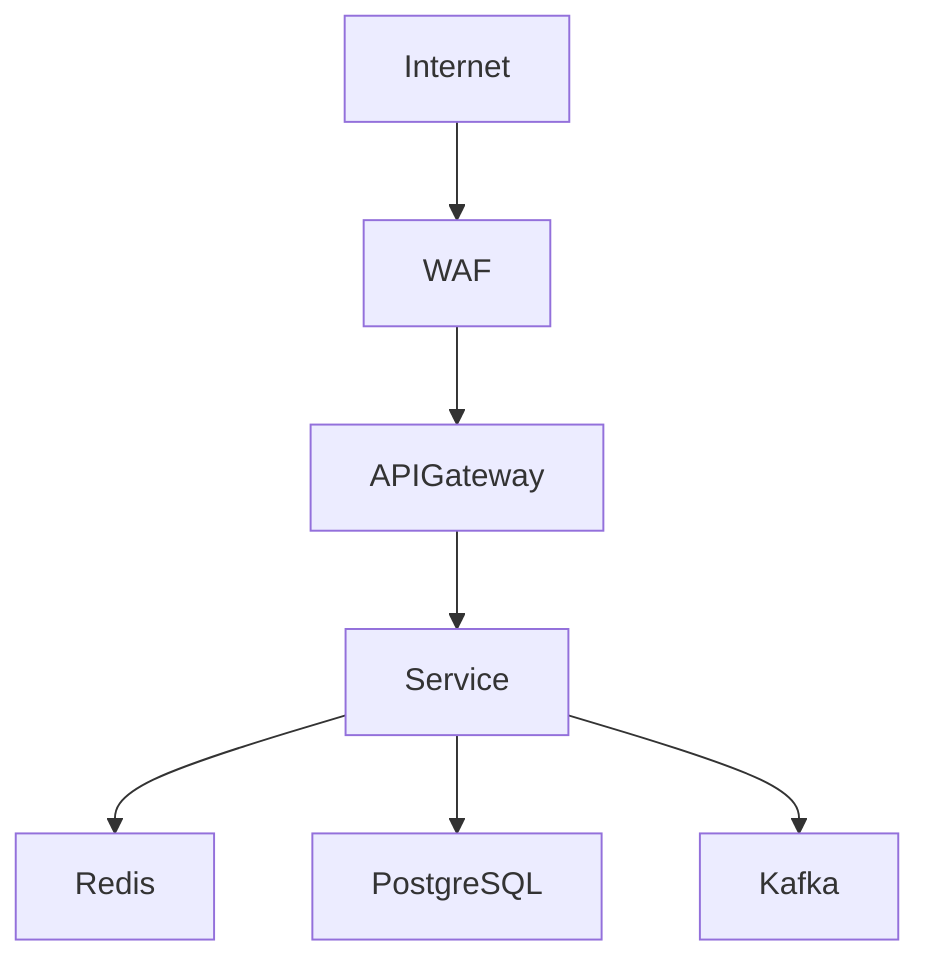

# ARCHITECTURE ASSESSMENT & RECOMMENDATION WORKSPACE V1

## Product Strategy

### Vision
Xây dựng nền tảng nội bộ hỗ trợ Solution Architect theo mô hình:

Assessment → Pattern Mapping → Reference Architecture → Proposal Generation

Thay vì:

Requirement → AI tự sinh kiến trúc.

### Thiết kế tham chiếu
- Azure Architecture Center
- Microsoft Cloud Adoption Framework
- Azure Well-Architected Framework

### Core Principles
1. AI không thiết kế kiến trúc.
2. Kiến thức nằm trong Pattern Library.
3. Kiến thức nằm trong Reference Architecture Repository.
4. AI chỉ hỗ trợ viết Proposal.

---

# V1 Scope

## Module 1 Assessment Engine
## Module 2 Architecture Pattern Mapping Engine
## Module 3 Reference Architecture Repository
## Module 4 Proposal Generator
## Module 5 Mermaid Diagram Generator

---

# Business Workflow

Assessment
→ Pattern Mapping
→ Reference Architecture Selection
→ Proposal Generation
→ Diagram Generation
→ PDF Export

---

# Assessment Engine

## Category A Business
- Industry
- Business Domain
- Number of Users
- Countries

## Category B Workload
- Concurrent Users
- Average TPS
- Peak TPS
- Data Volume Per Day
- Growth Rate

## Category C Availability
- SLA
- RTO
- RPO
- HA Required

## Category D Security
- Internet Facing
- PII Data
- PCI DSS
- MFA Required

## Category E Deployment
- Cloud
- Hybrid
- OnPrem

## Assessment Schema Example

```json
{
  "assessmentId":"ASM-001",
  "projectName":"Internet Banking",
  "industry":"Banking",
  "businessDomain":"Digital Banking",
  "concurrentUsers":20000,
  "avgTPS":1000,
  "peakTPS":3000,
  "sla":"99.99",
  "rto":"4h",
  "rpo":"15m",
  "internetFacing":true,
  "pii":true,
  "deployment":"Cloud"
}
```

---

# Architecture Pattern Engine

## Pattern Library

### P001
3-Tier Application

### P002
Microservice Platform

### P003
Event Driven Platform

### P004
Integration Hub

### P005
Data Platform

## Pattern Schema

```json
{
  "patternId":"P002",
  "patternName":"Microservice Platform",
  "description":"Distributed services",
  "industries":["Banking","Telecom"],
  "components":[
    "API Gateway",
    "Service",
    "Cache",
    "Database"
  ]
}
```

## Mapping Rule Example

```json
{
  "ruleId":"R001",
  "conditions":{
    "industry":"Banking",
    "concurrentUsers":">10000"
  },
  "targetPattern":"P002"
}
```

---

# Reference Architecture Repository

## Reference Architecture Schema

```json
{
  "referenceId":"RA001",
  "name":"Internet Banking",
  "patternId":"P002",
  "industry":"Banking"
}
```

## RA001 Internet Banking

Components:
- WAF
- API Gateway
- Microservices
- Redis
- Kafka
- PostgreSQL
- Elastic
- Prometheus

## RA002 CRM Platform

Components:
- Load Balancer
- Application
- Database
- Cache

## RA003 API Platform

Components:
- API Gateway
- Message Queue
- Database
- Monitoring

## RA004 Government Portal

Components:
- WAF
- Load Balancer
- Application
- Database

### V1 Requirement
Tối thiểu 10 Reference Architectures.

---

# Proposal Generator

## Input
- Assessment
- Pattern
- Reference Architecture

## AI Role
AI chỉ viết tài liệu.

## System Prompt

You are a senior enterprise solution architect.
Do not invent architecture.
Only use supplied assessment, pattern and reference architecture.
Generate professional proposal.

## Output Sections
- Executive Summary
- Requirement Assessment
- Architecture Overview
- Components
- Risks
- Recommendations

## Output Schema

```json
{
  "executiveSummary":"",
  "requirementSummary":"",
  "architectureOverview":"",
  "componentDescriptions":[],
  "risks":[],
  "recommendations":[]
}
```

---

# Mermaid Diagram Generator

## Input
Reference Architecture

## Example



---

# Database Design

## assessment
- assessment_id
- project_name
- industry
- assessment_json

## architecture_pattern
- pattern_id
- name
- description
- rule_json

## mapping_rule
- rule_id
- condition_json
- target_pattern

## reference_architecture
- reference_id
- name
- industry
- pattern_id
- definition_json
- mermaid_template

## generated_proposal
- proposal_id
- assessment_id
- reference_id
- markdown_content
- pdf_file

---

# UI Screens

01 Dashboard
02 New Assessment
03 Assessment Questionnaire
04 Assessment Summary
05 Recommended Pattern
06 Reference Architecture
07 Proposal Preview
08 Diagram Viewer
09 Export PDF

---

# Acceptance Criteria

AC01 Assessment completed in <10 minutes.

AC02 Pattern selected automatically.

AC03 At least one reference architecture recommended.

AC04 Proposal generated successfully.

AC05 Mermaid diagram rendered successfully.

AC06 PDF exported successfully.

---

# Vendor Deliverables

- Assessment Engine
- Pattern Mapping Engine
- Pattern Repository
- Reference Architecture Repository
- Proposal Generator
- Mermaid Diagram Generator
- PDF Export
- PostgreSQL Database
- REST API
- Docker Deployment

---

# KPI

KPI-01 Proposal Generation Time < 10 minutes

KPI-02 Reference Architecture Reuse > 80%

KPI-03 Proposal Completion Rate > 70%
