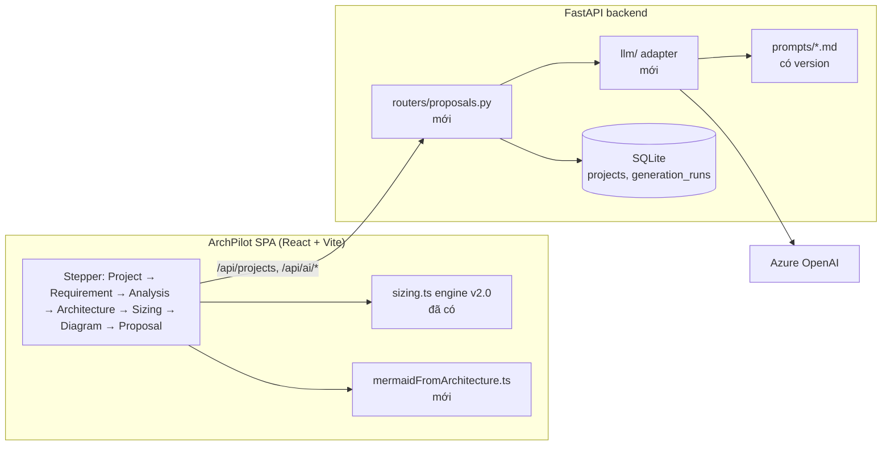

# Phương án xây dựng Demo V1 — AI Architecture Proposal (Quick-Win)

| Mục | Giá trị |
|---|---|
| Phiên bản | 0.1 (đề xuất) |
| Ngày | 2026-09-24 |
| Đầu vào | `PRD_AI_Solution_Architecture_Platform_v1.md`, `Demo_V1_QuickWin_Requirement_Prompts_Schema.md`, `Prompt_Engineering_Specification.md`, `UX_Screen_Specification.md`, `Architecture_Proposal_Template.md` |
| Phạm vi | Demo nội bộ 2–4 tuần cho đội Solution Architect (SA) |
| Trạng thái | Chờ PO chốt 3 quyết định ở mục 9 |

---

## 1. Tóm tắt

**Đề xuất:** xây Demo V1 thành **một luồng mới trong ArchPilot**. Không dựng dự án NextJS mới.

- ArchPilot đã có: đăng nhập + CSRF, workspace/designs API, **sizing engine v2.0 (34 test)**, bảng benchmark có trích dẫn, xuất Markdown, Docker, CI. Đây là khoảng 60% phần móng Demo V1 cần.
- Phần còn thiếu là **lớp AI**: một adapter gọi LLM, 3 prompt, bảng lưu project/kết quả, 1 màn hình dạng stepper, bộ sinh Mermaid và bộ xuất proposal.
- **Ước lượng: ~20 person-day (pd)**, tức 4 tuần với 1 developer, hoặc khoảng 2,5 tuần với 2 developer.

**Hai thay đổi so với tài liệu gốc, cả hai đều để demo đáng tin hơn:**

1. **Con số sizing do engine tính, không do LLM sinh.** LLM chỉ viết phần diễn giải. Lý do: LLM cho ra số khác nhau mỗi lần chạy, không truy vết được công thức, nên không thể chứng minh tiêu chí "sai số < 20%" của PRD. Engine hiện có đã trả về khoảng giá trị + công thức + giả định.
2. **Sơ đồ Mermaid được sinh bằng code từ JSON kiến trúc, không nhờ LLM viết.** Mermaid do LLM viết hay lỗi cú pháp, và không bảo đảm khớp với danh sách component. Sinh bằng code thì luôn render được và luôn khớp.

---

## 2. Bối cảnh: tài liệu nói gì, và chỗ nào chưa khớp

### 2.1 Luồng Demo V1

```
Business Requirement → AI Requirement Analysis → AI Architecture Generation
  → Sizing → Mermaid Diagram → Export Proposal (Markdown/PDF)
```

### 2.2 Những điểm chưa khớp giữa các tài liệu

| # | Vấn đề | Tài liệu | Cách xử lý đề xuất |
|---|---|---|---|
| G1 | PRD Giai đoạn 1 nói sizing là "rule engine + benchmark, **không phụ thuộc AI**". Demo V1 lại để LLM sinh sizing | PRD vs Demo V1 §4 | Engine tính số, LLM diễn giải (mục 1) |
| G2 | `dataFlow` là mảng chuỗi (`[""]`), nên không vẽ được sơ đồ từ nó | Demo V1 §3 | Đổi thành `{from, to, label}` tham chiếu `component.id` (mục 5.2) |
| G3 | Prompt spec bắt buộc 4 lớp (Entry/Application/Data/Observability). Template proposal có 5 lớp (thêm Integration). Schema `components` không có trường lớp | Prompt spec, Template | Thêm `layer` ∈ {edge, application, integration, data, observability}, kiểm tra đủ 4 lớp bắt buộc |
| G4 | Form thiếu các đầu vào mà sizing cần: thời gian lưu dữ liệu, tỉ lệ đọc/ghi | Demo V1 §2 | Thêm 2 trường có giá trị mặc định, hiển thị là "giả định" |
| G5 | PRD FR-RB-04 (Authentication, MFA, Encryption, Audit) không có trong form Demo | PRD vs Demo V1 | Thêm 1 nhóm checkbox "Security" (4 ô), rẻ và làm prompt tốt hơn |
| G6 | Không có benchmark cho Kafka/messaging | Engine hiện tại (service, database, cache) | Thêm 1 dòng benchmark `queue`, gắn nhãn `estimated` |
| G7 | "70% nội dung dùng trực tiếp" chưa có cách đo | Demo V1 Success Criteria | Bộ 5 kịch bản mẫu + SA chấm điểm (mục 7) |
| G8 | Stack: NextJS/Tailwind/ShadCN/PostgreSQL vs ArchPilot React-Vite/FastAPI/SQLite | Demo V1 Tech Stack | Dùng stack ArchPilot (mục 3) |

---

## 3. So sánh phương án

| Tiêu chí | **A. Trong ArchPilot (đề xuất)** | B. Dự án NextJS mới theo spec |
|---|---|---|
| Auth, CSRF, session | Có sẵn, đã test | Phải làm lại |
| Sizing engine + benchmark | Có sẵn (v2.0, có khoảng tin cậy) | Phải làm lại hoặc để LLM đoán |
| Docker, CI, backup | Có sẵn | Phải làm lại |
| Công sức ước tính | **~20 pd** | ~35–40 pd |
| Rủi ro 2–4 tuần | Thấp | Cao |
| Khác biệt với spec | Stack khác (React-Vite + FastAPI + SQLite) | Đúng spec |

SQLite đủ cho demo nội bộ vài người dùng. Khi cần nhiều người dùng đồng thời mới chuyển sang PostgreSQL. Tầng repository đã tách riêng nên đổi DB không ảnh hưởng API.

---

## 4. Kiến trúc Demo V1



**Nguyên tắc:**

- API key LLM chỉ nằm ở backend (biến môi trường), không bao giờ gửi xuống trình duyệt.
- Mỗi lần gọi LLM được lưu thành một `generation_run`: prompt version, model, input, output, số token, thời gian. SA chạy lại một bước mà không mất kết quả cũ.
- Output LLM **luôn được validate bằng JSON Schema** trước khi trả về. Sai schema thì tự retry 1 lần, sai lần 2 thì trả lỗi rõ ràng.

---

## 5. Thiết kế chi tiết

### 5.1 Dữ liệu (migration `006_demo_v1_proposals.sql`)

| Bảng | Cột chính | Ghi chú |
|---|---|---|
| `projects` | id, owner_id, name, customer, industry, description, created_at, updated_at | Owner-scoped như `designs` |
| `requirement_inputs` | project_id, form_json, revision | Form ở mục 2.2 (G4, G5) |
| `generation_runs` | id, project_id, step (`analysis`\|`architecture`\|`narrative`), prompt_version, model, input_json, output_json, status, tokens_in, tokens_out, latency_ms, created_at | Bản mới nhất theo `step` là kết quả hiện hành |
| `sizing_snapshots` | project_id, inputs_json, result_json, formula_version, benchmark_snapshot_json | Lưu để proposal tái lập được |

### 5.2 Schema output LLM (sửa so với spec gốc)

**Architecture** (thay G2, G3):

```json
{
  "architectureSummary": "",
  "architectureStyle": "Monolith|Microservices|EventDriven",
  "components": [
    { "id": "api-gw", "name": "API Gateway", "layer": "edge",
      "technology": "Kong", "purpose": "" }
  ],
  "dataFlow": [
    { "from": "api-gw", "to": "order-svc", "label": "REST/HTTPS" }
  ],
  "designDecisions": [{ "decision": "", "rationale": "" }],
  "risks": [{ "category": "scalability|availability|security|cost",
              "description": "", "mitigation": "" }]
}
```

Kiểm tra sau khi validate schema: mọi `from`/`to` phải trỏ tới `id` có thật; có đủ 4 lớp bắt buộc; không có `id` trùng.

**Requirement Analysis:** giữ nguyên schema gốc.

**Sizing:** LLM **không** có schema sizing. Bước `narrative` nhận kết quả engine và chỉ viết đoạn diễn giải cho mục "Infrastructure Sizing" và "Recommendations".

### 5.3 Ánh xạ form → sizing engine

| Thành phần | Đầu vào engine | Nguồn |
|---|---|---|
| Compute (service) | `avgQps = avgTPS`, `peakFactor = peakTPS / avgTPS` (tối thiểu 1) | Form |
| Database | như trên + `retentionMonths` | Form (mặc định 12) |
| Kích thước bản ghi | `dataGrowthGBPerDay ÷ số lần ghi mỗi ngày` (mặc định 2 KiB nếu = 0) | Suy ra, gắn nhãn giả định |
| Tỉ lệ đọc/ghi | mặc định 4:1 | Giả định, SA sửa được |
| Cache | engine tính node theo QPS; RAM = dữ liệu "nóng" giả định 20% của 30 ngày | Giả định |
| Messaging | benchmark `queue` mới; số broker = max(3, kết quả engine) | G6 |
| vCPU/RAM | số node × cấu hình trong `basis` của benchmark (vd. 4 vCPU/8 GB) | Benchmark |

Mọi con số hiển thị dạng **khoảng + điểm ước tính + nhãn độ tin cậy**, ví dụ `6–10 node (ước tính 8)`. Proposal ghi rõ "baseline estimation, không phải sizing production" (đúng yêu cầu Prompt spec).

### 5.4 API

| Method | Path | Việc | LLM? |
|---|---|---|---|
| POST/GET | `/api/projects`, `/api/projects/{id}` | Tạo, liệt kê, xem | Không |
| PUT | `/api/projects/{id}/requirements` | Lưu form | Không |
| POST | `/api/projects/{id}/ai/analysis` | Requirement Analysis | Có |
| POST | `/api/projects/{id}/ai/architecture` | Sinh kiến trúc từ analysis | Có |
| PUT | `/api/projects/{id}/sizing` | Lưu snapshot sizing (tính ở SPA) | Không |
| POST | `/api/projects/{id}/ai/narrative` | Diễn giải sizing + khuyến nghị | Có |
| GET | `/api/projects/{id}/proposal.md` | Ghép proposal Markdown | Không |

Khác spec gốc: API gom theo `project` để đúng mô hình owner-scoped hiện có. Diagram và proposal không cần gọi LLM riêng nên không có endpoint AI tương ứng.

### 5.5 Proposal: code ghép, LLM chỉ viết văn

`Architecture_Proposal_Template.md` được giữ nguyên làm khung. Phần nào có dữ liệu chính xác thì **code điền**: bảng workload, bảng sizing, sơ đồ Mermaid, danh sách component theo lớp, giả định, rủi ro. LLM chỉ viết Executive Summary, phần diễn giải sizing và Recommendations theo Phase 1/2.

Kết quả: không có con số nào trong proposal do LLM tự nghĩ ra, và 3 lời gọi LLM thay vì 5.

**Xuất file:** Markdown tải trực tiếp. PDF qua trang in của trình duyệt với print stylesheet riêng, không cần thư viện server. Sơ đồ xuất SVG/PNG từ Mermaid render phía client.

### 5.6 Giao diện (theo `UX_Screen_Specification.md`)

- Screen 01 Dashboard: thêm thẻ "Projects" vào trang Overview có sẵn.
- Screen 02–08: **một màn hình stepper** `src/features/proposal/`, đúng nguyên tắc "single page workflow, tối đa 3 click". Mỗi bước có nút "Chạy lại" và cho SA sửa kết quả trước khi sang bước sau.
- Song ngữ VI/EN theo cơ chế `copy()` hiện có.

---

## 6. Kế hoạch thực hiện

| Tuần | # | Việc | pd | Agent phụ trách | Kiểm chứng |
|---|---|---|---|---|---|
| 1 | 1 | Migration 006, `/api/projects` + requirements, form (G4, G5) | 3 | senior-developer-1, dba-master | pytest CRUD + owner-scope; form lưu/đọc lại |
| 1 | 2 | Adapter LLM: Azure OpenAI, JSON mode, validate schema, retry 1 lần, timeout 30 s, log token (không log nội dung) | 2.5 | senior-developer-1 | Test với LLM giả (fake adapter), không gọi mạng trong CI |
| 1 | 3 | Prompt Analysis + Architecture, lưu thành file có version | 1.5 | solution-architect-1 | Chạy trên 5 kịch bản mẫu, 100% JSON hợp lệ |
| 2 | 4 | Endpoint analysis/architecture + kiểm tra tham chiếu `id` và 4 lớp | 2 | senior-developer-1 | Test case output hỏng: id trỏ sai, thiếu lớp |
| 2 | 5 | Stepper UI bước 02–05 | 3 | senior-developer-1 | vitest + chạy tay trên trình duyệt |
| 2 | 6 | Ánh xạ form → engine, benchmark `queue`, màn hình Sizing | 2 | senior-developer-1, dba-master | Test đơn vị ánh xạ; so với 5 kịch bản mẫu |
| 3 | 7 | `mermaidFromArchitecture.ts` + render + xuất SVG/PNG | 1.5 | senior-developer-1 | Sinh sơ đồ < 10 s; render được cho cả 5 kịch bản |
| 3 | 8 | Narrative prompt + ghép proposal + print PDF | 2 | senior-developer-1 | Proposal đủ mọi mục của template |
| 3 | 9 | Code review + hardening | 1.5 | senior-developer-2, security-architect | Không còn finding mức High |
| 4 | 10 | Đánh giá chất lượng + demo (mục 7) | 1 | ba-qa-analyst | Đạt tiêu chí mục 7 |
|   |   | **Tổng** | **20** | | |

**Có thể làm song song:** việc 3 (prompt) song song với việc 1–2; việc 6 (sizing) không phụ thuộc LLM nên làm song song với việc 4–5.

---

## 7. Tiêu chí nghiệm thu và cách đo

| Tiêu chí (từ spec) | Cách đo |
|---|---|
| Tạo proposal < 15 phút | SA mới dùng lần đầu, bấm giờ trên 5 kịch bản mẫu |
| Diagram sinh tự động, < 10 s | Tự động: 5/5 kịch bản render không lỗi |
| Mỗi phản hồi AI < 30 s | Đo `latency_ms` trong `generation_runs`, p95 |
| Xuất PDF/Markdown | Kiểm tra tay 2 định dạng |
| 70% nội dung dùng trực tiếp | 2 SA chấm từng mục proposal: *dùng được / sửa nhẹ / viết lại*. Đạt nếu (dùng được + sửa nhẹ) ≥ 70% |
| Sizing sai số < 20% (PRD) | So điểm ước tính của engine với ước tính của SA trên 5 kịch bản |

**Bộ 5 kịch bản mẫu** (ba-qa-analyst soạn tuần 1): core banking, e-commerce mùa cao điểm, cổng dịch vụ công, hệ thống viễn thông OSS, ứng dụng nội bộ nhỏ. Mỗi kịch bản có sẵn đáp án sizing và kiến trúc do SA viết.

---

## 8. Rủi ro và giảm thiểu

| Rủi ro | Mức | Giảm thiểu |
|---|---|---|
| Dữ liệu khách hàng (banking, chính phủ) được gửi tới LLM bên ngoài | Cao | Dùng Azure OpenAI trong tenant của công ty, tắt lưu log phía nhà cung cấp nếu hợp đồng cho phép; tùy chọn **ẩn tên khách hàng** trước khi gửi; banner nhắc không nhập thông tin mật |
| LLM trả JSON sai hoặc kiến trúc không nhất quán | Trung bình | JSON mode + validate schema + kiểm tra tham chiếu + retry 1 lần |
| Khách hàng xem sizing ước tính như cam kết | Trung bình | Luôn hiển thị khoảng + nhãn độ tin cậy + câu "baseline estimation" trong proposal |
| Chất lượng prompt không đạt 70% | Trung bình | Prompt có version, đánh giá trên bộ 5 kịch bản mỗi lần sửa |
| Chi phí token vượt kiểm soát | Thấp | Log token theo run; giới hạn số lần chạy lại mỗi bước |
| Server lưu con số sizing do client tính (rủi ro D3 đã biết) | Thấp cho demo | Lưu `benchmark_snapshot_json` để tái lập; kiểm tra phía server để sau demo |

---

## 9. Quyết định cần PO chốt

1. **Stack:** đồng ý xây trong ArchPilot (Phương án A), không làm NextJS mới? *Đề xuất: A.*
2. **Nhà cung cấp LLM:** Azure OpenAI như spec? Cần tên deployment/model và tenant để cấu hình. Adapter viết theo interface nên đổi nhà cung cấp sau chỉ cần thêm một adapter.
3. **Sizing:** đồng ý engine tính số, LLM chỉ diễn giải (G1)? *Đề xuất: đồng ý.* Đây là thay đổi so với spec Demo V1 §4.

## 10. Câu hỏi mở

- Có được dùng dữ liệu dự án thật để làm bộ 5 kịch bản mẫu không, hay phải dùng dữ liệu giả?
- Proposal có cần logo/định dạng công ty khi xuất PDF không?
- Demo chạy trên máy cá nhân (theo `09-pc-deployment-guide.md`) hay trên server chung?

## 11. Tham chiếu và bàn giao tiếp theo

- Sizing engine: `src/domain/sizing.ts`, thiết kế tại `docs/systemsarchitect-build-scope.md` §3.6
- Benchmark: `backend/app/repositories/benchmarks.py`, `backend/app/migrations/004_benchmark_seed.sql`
- Mẫu router owner-scoped: `backend/app/routers/designs.py`
- **Bước tiếp theo:** sau khi PO chốt mục 9, giao **ba-qa-analyst** soạn bộ 5 kịch bản mẫu, đồng thời giao **senior-developer-1** bắt đầu việc 1–2.
