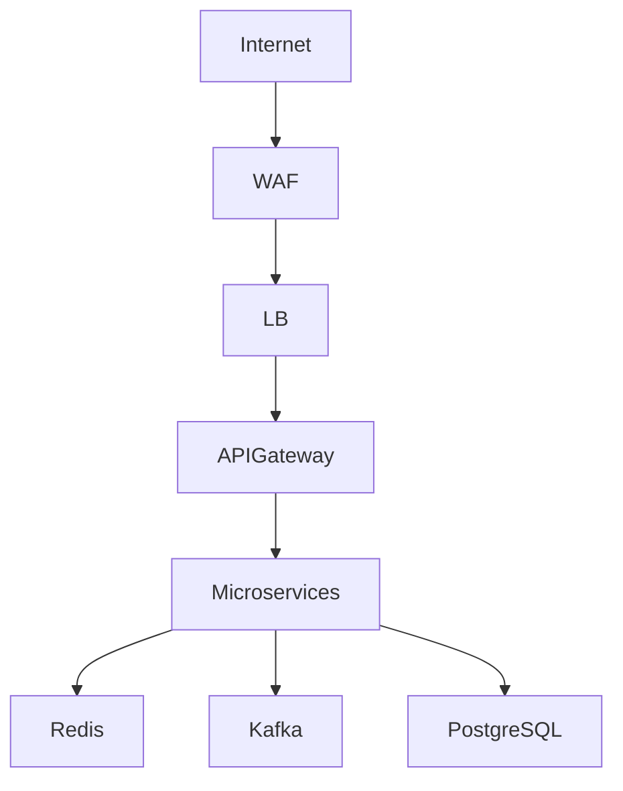

# Requirement Specification - Demo V1 (Quick-Win)

## Mục tiêu
Xây dựng demo nội bộ trong 2-4 tuần phục vụ đội Solution Architect.

Workflow:

Business Requirement
→ AI Requirement Analysis
→ AI Architecture Generation
→ AI Sizing Generation
→ Mermaid Diagram
→ Export Proposal

---

# 1. Functional Scope

## Module 1 - Project Workspace

### Input
- Project Name
- Customer
- Industry
- Description

### Output
- Project Workspace

---

## Module 2 - Requirement Builder

### Form Schema

```json
{
  "projectName":"",
  "industry":"Banking|Finance|Government|Telecom|Retail|Other",
  "businessDomain":"",
  "deploymentModel":"Cloud|OnPrem|Hybrid",
  "users":0,
  "activeUsers":0,
  "concurrentUsers":0,
  "avgTPS":0,
  "peakTPS":0,
  "sla":"99.9",
  "rto":"4h",
  "rpo":"15m",
  "dataGrowthGBPerDay":0,
  "notes":""
}
```

---

# 2. AI Requirement Analysis

## Prompt System

```text
You are a Senior Enterprise Solution Architect.

Analyze the provided business and workload requirements.

Generate:
1. Workload Summary
2. Non Functional Requirements
3. Security Requirements
4. Scalability Requirements
5. Availability Requirements
6. Assumptions

Return JSON only.
```

## Prompt User Template

```text
Project: {{projectName}}
Industry: {{industry}}
Concurrent Users: {{concurrentUsers}}
Average TPS: {{avgTPS}}
Peak TPS: {{peakTPS}}
SLA: {{sla}}
RTO: {{rto}}
RPO: {{rpo}}
Deployment: {{deploymentModel}}
```

## Output Schema

```json
{
  "workloadSummary":"",
  "nfr":[""],
  "securityRequirements":[""],
  "availabilityRequirements":[""],
  "scalabilityRequirements":[""],
  "assumptions":[""]
}
```

---

# 3. AI Architecture Generator

## Prompt System

```text
You are a Lead Solution Architect.

Design a production-ready architecture.

Generate:
1. Architecture Overview
2. Components
3. Data Flow
4. Design Decisions
5. Risks

Return JSON only.
```

## Input

Requirement Analysis Output.

## Output Schema

```json
{
  "architectureSummary":"",
  "architectureStyle":"Microservice",
  "components":[
    {
      "name":"API Gateway",
      "purpose":""
    }
  ],
  "dataFlow":[""],
  "designDecisions":[""],
  "risks":[""]
}
```

---

# 4. AI Sizing Generator

## Prompt System

```text
You are an Infrastructure Architect.

Provide high-level infrastructure sizing.

Generate:
- Compute
- Database
- Cache
- Messaging
- Storage

Return JSON only.
```

## Output Schema

```json
{
  "compute":{
    "nodeCount":0,
    "vcpu":0,
    "ramGB":0
  },
  "database":{
    "topology":"",
    "storageTB":0
  },
  "cache":{
    "nodeCount":0,
    "memoryGB":0
  },
  "messaging":{
    "technology":"Kafka",
    "nodeCount":0
  },
  "storage":{
    "sizeTB":0
  }
}
```

---

# 5. Mermaid Diagram Generator

## Prompt System

```text
Generate Mermaid architecture diagram.

Rules:
- Use graph TD.
- Include all major components.
- Return Mermaid code only.
```

## Example Output



---

# 6. Proposal Generator

## Prompt System

```text
Create architecture proposal document.

Sections:
1. Executive Summary
2. Requirement Analysis
3. Architecture Design
4. Infrastructure Sizing
5. Architecture Diagram
6. Risks
7. Recommendations

Return Markdown.
```

## Output Schema

```json
{
  "proposalMarkdown":"markdown content"
}
```

---

# API Design

## POST /api/projects
Create Project

## POST /api/requirements/analyze
Run Requirement Analysis

## POST /api/architecture/generate
Generate Architecture

## POST /api/sizing/generate
Generate Sizing

## POST /api/diagram/generate
Generate Mermaid Diagram

## POST /api/proposal/generate
Generate Proposal

---

# Success Criteria

- Tạo proposal dưới 15 phút.
- Diagram sinh tự động.
- Xuất PDF/Markdown.
- 70% nội dung proposal có thể sử dụng trực tiếp.

---

# Tech Stack

Frontend
- NextJS
- Tailwind
- ShadCN

Backend
- NextJS API

Database
- PostgreSQL

AI
- Azure OpenAI GPT

Diagram
- MermaidJS
